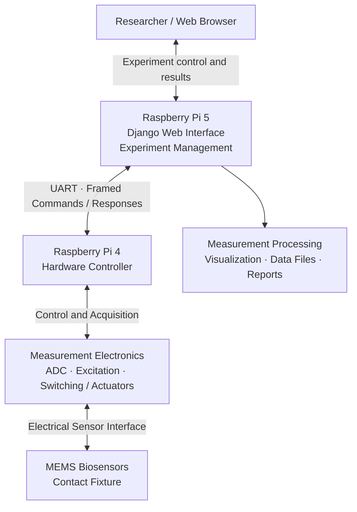

  

<h1 align="center">Compact Impedance Sensing System Platform</h1>

<strong>MEMS Biosensors · Scientific Instrumentation · Embedded Systems · Hardware–Software Integration</strong>

A compact research instrument combining microfabricated impedance biosensors, custom mechanical design, Raspberry Pi hardware control, and web-based experimental measurements.

<a href="https://github.com/Kamran00786">Portfolio</a> · <a href="https://scholar.google.com/citations?user=VaxZYvwAAAAJ&hl=en">Google Scholar</a> · <a href="https://www.linkedin.com/in/kamran-bashir-taas-b2333a212/">LinkedIn</a>

> **Public engineering showcase — no source code included.** This repository describes engineering contributions to a collaborative university research system. Source files, complete hardware designs, and research data are not published here.
Project Overview
The Compact Impedance Sensing System Platform integrates MEMS biosensor fabrication, mechanical prototyping, electronics, distributed embedded control, and software for automated experiments. It was developed as part of biosensing and scientific instrumentation research at the University of Missouri.
A Raspberry Pi 5 hosts the Python/Django web interface and experimental workflow. It communicates over UART with a Raspberry Pi 4 that handles hardware control and acquisition. The platform brings sensor interfaces, excitation and acquisition electronics, and data processing into one integrated measurement workflow.
From Sensor Design to Instrumentation
Stage	Engineering work
1 — MEMS sensor design	Designed biosensor layouts and hard masks using L-Edit.
2 — Cleanroom microfabrication	Worked with photolithography, Cr/Au thin films, wet/dry etching, electroplating, and PDMS packaging.
3 — Fabricated device evaluation	Inspected fabricated sensors and integrated sensor-contact fixtures for electrical measurements.
4 — Mechanical CAD	Designed the compact enclosure and component arrangement using SolidWorks and Autodesk Fusion 360.
5 — 3D printing & instrument assembly	Created custom 3D-printed supporting components and assembled the electronics, controllers, sensor fixtures, and mechanical structure.
6 — Raspberry Pi hardware control	Integrated Raspberry Pi 5 and Raspberry Pi 4 using serial UART command-and-response messaging.
7 — Web-based instrumentation	Developed a Python/Django interface for controlling experimental operations and reviewing measurements.
8 — Data acquisition & analysis	Supported ADC acquisition, calibration workflows, experiment processing, data visualization, and reporting.
High-Level System Architecture
This is a functional overview, not a disclosure of detailed circuit schematics, calibration constants, or proprietary implementation parameters.

My Engineering Contributions
MEMS Biosensor Design & Fabrication
Designed sensor layouts and fabrication masks using L-Edit.
Fabricated and evaluated MEMS structures on glass and silicon substrates using cleanroom processes.
Applied photolithography, thin-film deposition, etching, electroplating, and PDMS packaging methods.
Developed a contact-pin test fixture to interface multiple biosensors with measurement electronics.
SolidWorks, Fusion 360 & Rapid Prototyping
Modeled the instrument enclosure and internal component placement in SolidWorks and Autodesk Fusion 360.
Designed and fabricated 3D-printed supporting parts for mechanical integration and prototyping.
Assembled the compact instrument using the finalized mechanical design, sensing fixture, electronic boards, and embedded controllers.
Electronics & Embedded Integration
Simulated analog front-end and excitation circuits using LTspice.
Integrated measurement electronics, sensor interfaces, control and switching hardware, and Raspberry Pi controllers.
Connected the Django application on the Pi 5 to the Pi 4 hardware controller using UART.
Scientific Software & Measurement Workflows
Developed a browser-based Python/Django interface for instrument configuration and operation.
Implemented serial communication between the two Raspberry Pis and hardware acquisition workflows.
Developed experiment processing, measurement visualization, and reporting for multi-electrode measurements.
Skills & Technologies
Domain	Tools and technologies
Sensor design & MEMS fabrication	L-Edit, photolithography, thin-film processing, etching, electroplating, PDMS packaging
Mechanical design & prototyping	SolidWorks, Fusion 360, 3D CAD, 3D printing, enclosure design, mechanical assembly
Electronic instrumentation	LTspice, analog-front-end prototyping, ADC-based acquisition, excitation and switching hardware
Embedded integration	Raspberry Pi 4 & 5, UART, serial command/response systems, hardware control
Software & data analysis	Python, Django, web UI, measurement processing, visualization and report generation
Experimental Evaluation
The system was used to evaluate fabricated MEMS biosensors, and measurements were compared with a commercial impedance analyzer as part of the research workflow. Detailed datasets, calibration settings, and quantitative performance metrics are intentionally not disclosed here. This showcase does not claim clinical or diagnostic regulatory approval.
Research Context & Attribution
This platform was developed through collaborative research at the University of Missouri. This page highlights Kamran Bashir Taas's engineering contributions without implying sole ownership of all research outputs, designs, or intellectual property.
For related publications, please visit my Google Scholar profile.
Source Code & Technical Material
The complete source code is not publicly available.
The Django application, hardware-control implementation, detailed device designs, and research measurements are not provided in this public repository. Requests to review selected technical materials may be considered case by case, subject to my agreement and any applicable university authorization, research intellectual-property rules, and confidentiality obligations. A request does not guarantee access.
For professional or research inquiries, please contact me via GitHub or LinkedIn.
---

<em>From MEMS sensor fabrication to 3D mechanical integration, embedded control, and web-based scientific measurements.</em>

