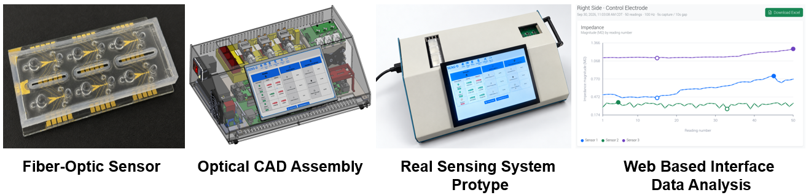
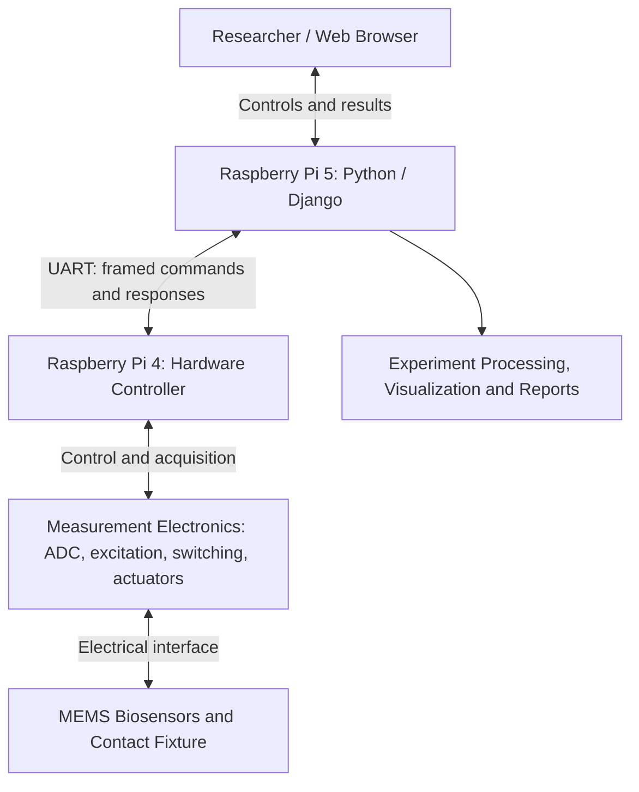

<h1 align="center">Web-Based Compact Impedance Sensing System Platform</h1>

  <strong>MEMS Biosensors · Scientific Instrumentation · Embedded Systems · Hardware–Software Integration</strong>

  A compact research instrument integrating microfabricated impedance biosensors, mechanical design, 
  Raspberry Pi hardware control, and web-based experimental measurements.

  <a href="https://github.com/Kamran00786">Engineering Portfolio</a> ·
  <a href="https://scholar.google.com/citations?user=VaxZYvwAAAAJ&hl=en">Google Scholar</a> ·
  <a href="https://www.linkedin.com/in/kamran-bashir-taas-b2333a212/">LinkedIn</a>

> **Public engineering showcase — no source code included.** This repository presents the engineering design, integration, and research context of a collaborative university project. Detailed source files, hardware designs, and research datasets are not publicly released.

## Project Overview

The **Compact Impedance Sensing System Platform** combines MEMS biosensor fabrication, custom mechanical prototyping, electronics, distributed embedded hardware control, and software for automated experimental measurements. The system was developed in the context of biosensing and scientific instrumentation research at the **University of Missouri**.

A **Raspberry Pi 5** hosts the Python/Django web interface and coordinates experiments. It communicates through **UART** with a **Raspberry Pi 4** hardware controller responsible for acquisition and device operations. The platform integrates the sensor-contact fixture, measurement electronics, acquisition workflow, data analysis, and result reporting.

## System Overview — From MEMS Sensor to Impedance Measurements

*Figure 1. Compact impedance sensing instrument with its custom enclosure, integrated touchscreen interface, and sensor/electronics access points. The platform combines MEMS-based sensing, embedded hardware control, and web-based measurement workflows.*

## Engineering Workflow: From Sensor Design to Instrumentation

| Stage | Engineering activities |
| :--- | :--- |
| **1. MEMS sensor design** | Biosensor layout and fabrication-mask design using **L-Edit**. |
| **2. Cleanroom microfabrication** | Photolithography, Cr/Au thin-film deposition, wet/dry etching, electroplating, and PDMS packaging. |
| **3. Fabricated sensor evaluation** | Device inspection, sensor-interface development, and electrical measurement preparation. |
| **4. Mechanical CAD** | Instrument enclosure, component placement, and mechanical design using **SolidWorks** and **Autodesk Fusion 360**. |
| **5. 3D printing & assembly** | Custom **3D-printed components**, sensor-contact fixtures, electronics mounting, and instrument integration. |
| **6. Embedded hardware control** | **Raspberry Pi 5 ↔ Raspberry Pi 4** communication using the **UART** command/response interface. |
| **7. Web-based instrument control** | **Python/Django** interface for experiment configuration, hardware operations, and measurement visualization. |
| **8. Measurement & analysis** | ADC data acquisition, calibration workflows, experimental data processing, and reports. |

## High-Level System Architecture

The diagram illustrates the major functional subsystems and communication flow. It is intentionally **not** a detailed electronic schematic or a disclosure of device-specific configuration.

The hardware–software split separates the researcher-facing application from low-level instrument operations. The frontend/backend communication described here is **between two physical Raspberry Pi devices** using UART.

## My Engineering Contributions

### 1. MEMS Biosensor Design & Fabrication

- Designed MEMS sensor layouts and fabrication masks using **L-Edit**.
- Fabricated and evaluated biosensor structures on glass and silicon substrates using cleanroom microfabrication processes.
- Worked with photolithography, thin-film processing, etching, electroplating, and PDMS packaging.
- Developed a contact-pin test fixture for interfacing multiple biosensors with measurement electronics.

### 2. SolidWorks, Fusion 360 & 3D Printing

- Designed and evaluated the compact instrument **enclosure, internal layout, and component placement**.
- Developed **3D CAD models** using **SolidWorks** and **Autodesk Fusion 360**.
- Created **3D-printed supporting parts** for instrument prototyping and mechanical integration.
- Integrated mechanical components, electronics, sensor fixtures, and Raspberry Pi controllers into the assembled sensing platform.

### 3. Electronic Instrumentation & Embedded Control

- Simulated analog front-end and excitation circuitry using **LTspice** and worked on electronic prototypes.
- Integrated ADC acquisition, excitation, sensor switching, and related hardware-control functions.
- Connected the Raspberry Pi 5 application to the Raspberry Pi 4 controller through a **UART serial command/response protocol**.

### 4. Scientific Software & Measurement Workflows

- Developed a **Python/Django** web-based user interface on **Raspberry Pi 5**.
- Integrated web-facing experiment control with the **Raspberry Pi 4** hardware controller.
- Worked on acquisition, calibration, multi-electrode measurement processing, visualization, and report generation.

## Skills & Technologies

| Domain | Tools, methods and technologies |
| :--- | :--- |
| **MEMS & microfabrication** | L-Edit, photolithography, Cr/Au processing, wet/dry etching, electroplating, PDMS packaging |
| **CAD & rapid prototyping** | SolidWorks, Autodesk Fusion 360, instrument enclosures, 3D CAD, 3D printing, mechanical assembly |
| **Electronics & testing** | LTspice, analog front-end, excitation circuitry, ADC-based acquisition, switching and sensor fixtures |
| **Embedded systems** | Raspberry Pi 5, Raspberry Pi 4, UART, serial device communication, hardware control |
| **Software & scientific analysis** | Python, Django, web UI, experiment workflows, data visualization, reporting |

## Experimental Evaluation

The platform was used to evaluate fabricated MEMS biosensors. The research workflow included comparisons with a commercial impedance analyzer. Detailed calibration settings, measurements, and quantitative performance metrics are intentionally excluded from this public showcase.

**Note:** This repository does not claim clinical validation or regulatory approval for medical diagnosis.

## Research Context & Attribution

This platform was developed through **collaborative research at the University of Missouri**. This portfolio documents **Kamran Bashir Taas's engineering contributions** without implying sole ownership of the research results, hardware designs, or intellectual property.

Related publications and research activity: [Google Scholar](https://scholar.google.com/citations?user=VaxZYvwAAAAJ&hl=en).

## Source Code & Technical Material

**The complete source code is not publicly available.** The Django application, hardware-control implementation, detailed CAD/design files, and underlying experimental datasets are not included in this repository.

Requests to review selected technical materials may be considered **on a case-by-case basis**, with my permission and subject to any required **university authorization, intellectual-property obligations, and confidentiality restrictions**. Submission of a request does not guarantee access.

For professional or research inquiries, please contact me through [GitHub](https://github.com/Kamran00786) or [LinkedIn](https://www.linkedin.com/in/kamran-bashir-taas-b2333a212/).

---

<em>From sensor design and microfabrication to mechanical prototyping, embedded communication, and scientific measurements.</em>

